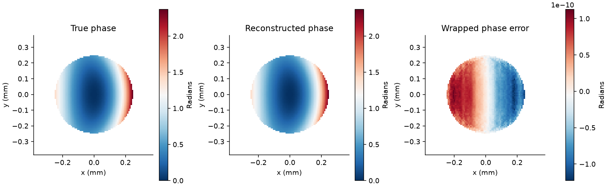
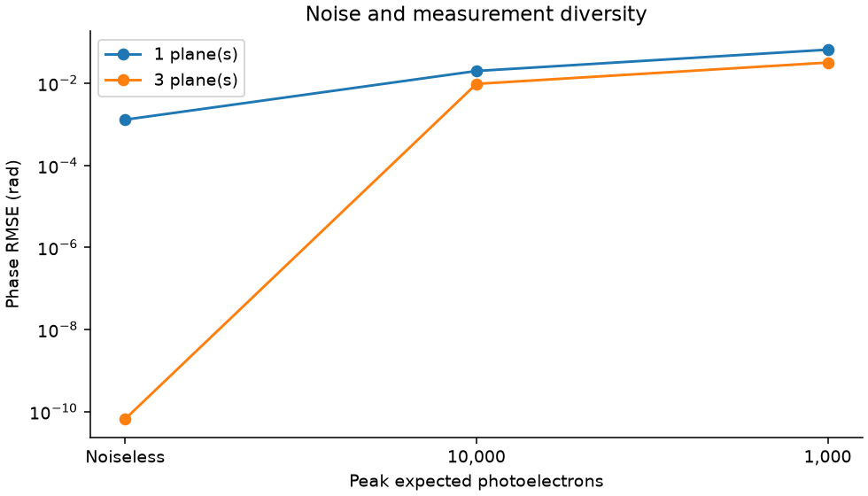

# Fourier optics and multi-plane wavefront reconstruction

## Standalone repository quick start

This repository contains the complete source, executed notebooks, technical report, retained datasets, figures and project-specific tests. No other project folder is required.

```powershell
python -m venv .venv
.\.venv\Scripts\python.exe -m pip install -e ".[test,notebooks]"
.\.venv\Scripts\python.exe verify.py
.\.venv\Scripts\python.exe -m pytest -q
.\.venv\Scripts\python.exe reproduce.py --profile smoke --run-tag smoke-check
```

Use `.venv/bin/python` on Linux/macOS. Run `reproduce.py --profile standard --run-tag my-run` for the full investigation. The `research` profile is available but its results are not claimed. `run.py` is the baseline; `study.py` contains extensions.

Open `notebooks/` in VS Code and select this virtual environment. `report/technical_report.md` explains the methods and findings. `results/` contains the retained standard study, and `published/manifest.json` records its hashes. `verify.py` is read-only and does not retrain. Prior default results are archived before reproduction; tagged runs leave retained results unchanged.

All data are synthetic. The implementation and initial writing were developed with AI assistance. The cited scientific methods are established; algorithmic novelty is not claimed. `environment-tested.txt` records the full development environment, including optional tools; `pyproject.toml` lists this project's actual installation requirements.

This study reconstructs a synthetic aberrated wavefront from propagated intensity images, given its object-plane amplitude. It compares one versus three observation planes and examines Poisson photon noise. The goal is to understand the information supplied by intensity measurements and propagation diversity.





## Forward model

For a coherent scalar paraxial field, the sampled Fresnel operator is

$$P_z[u]=\mathcal F^{-1}\{\mathcal F[u]\exp[-i\pi\lambda z(f_x^2+f_y^2)]\}.$$

The constant carrier phase is omitted because intensity and piston-aligned phase error do not depend on it. Sampling is periodic; propagation has no physical absorbing boundary. The finite grid must be large enough to avoid wraparound and fine enough to resolve the field. Forward/backward round-trip agreement validates the discrete operator, not the absence of sampling artifacts in a physical experiment.

The default grid is 96×96 at 8 micrometre pitch, wavelength 532 nm, with observation distances 25,55,85 mm. Input amplitude is an aperture-truncated Gaussian of radius 0.25 mm. A smooth polynomial phase combines defocus, astigmatism and a coma-like term. Its terms are illustrative, not normalized Zernike coefficients.

## Reconstruction

Start from the known amplitude and a small random phase. For each measurement plane, propagate the object estimate, replace its amplitude by the square root of measured intensity, retain its phase, and back-propagate. Average the back-propagated fields, then restore the known object amplitude. Repeat 250 iterations.

The objective logged is mean relative squared amplitude residual over the selected planes, evaluated before each projection update. This alternating-projection procedure can stagnate. It does not provide a global optimum or a uniqueness certificate, and known object amplitude is a strong prior.

## Measurements and evaluation

Compare noiseless data and Poisson counts with peak expected counts 10,000 and 1,000 photoelectrons at the brightest sampled pixel. Counts are converted back to the original intensity units. This is a photon-noise model only: no read noise, dark current, saturation, gain uncertainty or pixel integration.

For each noise setting, reconstruct with the first plane alone and all three planes. Evaluate wrapped phase RMS over pixels whose known object amplitude exceeds 0.2, after removing global phase (piston). Phase at zero amplitude is undefined and is excluded. The error is not an unwrapped optical-path-difference metric.

## Reproduce and inspect

The upgraded study is `python reproduce.py --profile standard`. The baseline below is preserved, while the extended investigation uses a larger 192×192 field of view and a raised-cosine pupil taper after the original hard-aperture sampling audit exposed about 10.4% window dependence. This changes the pupil model and is documented explicitly.

The extension includes three noise/initialization seeds, a held-out intensity plane, ±1% wavelength mismatch, padding and half-pitch comparisons. See the [technical report](report/technical_report.md) and [three notebooks](notebooks/). Added outputs are `noisy_reconstruction.png`, `robustness.png`, `advanced_data.npz` and `advanced_metrics.json`. More planes do not uniformly improve this estimator under noise in the retained experiments.

Run `python run.py` from this repository root after installation.

- `results/phase_reconstruction.png`: true phase, recovered phase and piston-aligned error for the noiseless three-plane case.
- `results/convergence.png`: amplitude residual for that case.
- `results/noise_comparison.png`: one-plane versus three-plane phase error at each photon setting.
- `results/study_data.npz`: true/recovered complex fields, intensity planes and physical sampling metadata.
- `results/metrics.json`: all six combinations, phase errors, residuals and measurement assumptions.

Tests check plane-wave invariance, discrete energy conservation, round-trip propagation, and reduction of both intensity residual and phase error on an independent small synthetic case. The baseline uses one noise draw and initialization per setting. The extended study adds three combined noise/initialization seeds, grid/window checks, a held-out observation plane and wavelength mismatch. These checks do not independently separate noise variability from initialization variability, and propagation-distance calibration remains a further sensitivity test.

## References

1. J. W. Goodman, *Introduction to Fourier Optics*, 4th ed., W. H. Freeman / Macmillan Learning (2017). [Publisher](https://www.macmillanlearning.com/ed/uk/product/Introduction-to-Fourier-Optics-4th-edition/p/1319119166). Background for scalar diffraction, Fresnel propagation and Fourier-domain optical modelling.
2. J. R. Fienup, “Phase retrieval algorithms: a comparison,” *Applied Optics* **21**(15), 2758–2769 (1982). [DOI](https://doi.org/10.1364/AO.21.002758). Iterative phase-retrieval constraints, error reduction and algorithmic limitations.
3. R. W. Gerchberg and W. O. Saxton, “A practical algorithm for the determination of phase from image and diffraction plane pictures,” *Optik* **35**, 237–246 (1972). Foundational alternating amplitude/phase projection method. The multi-plane averaging estimator used here is an educational variant rather than a reproduction of the original experiment.
